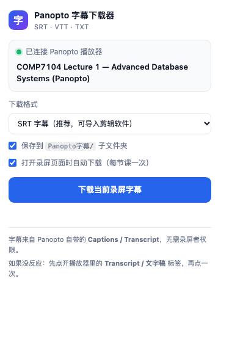

# Panopto 字幕下载器（Edge / Chrome 扩展）

一键把 Panopto 录屏里的**字幕 / 文字稿**下载成 `SRT`、`VTT` 或 `TXT`。
适用于 HKU Panopto（`hku.ap.panopto.com`）以及任何 `*.panopto.com` / `*.panopto.eu` 站点，
**不需要录屏者权限**，只要你自己能正常观看这个视频就行。



---

## 1. 功能

| 功能 | 说明 |
| --- | --- |
| 下载当前录屏字幕 | 打开任意 Panopto 播放页 → 点插件图标 → 下载 |
| 三种格式 | `SRT`（带时间轴，可导入播放器/剪辑软件）、`VTT`、`TXT` |
| 两种文字稿 | 带 `[12:34]` 时间戳的 TXT，或去掉时间戳的纯文字（适合做笔记、翻译、喂给 AI） |
| 自动下载 | 打开录屏页时自动存一份，每节课只存一次，不会重复打扰 |
| 批量下载 | 在 Panopto 课程 / 文件夹列表页，一次下载本页全部录屏字幕 |
| 自动命名 | 用录屏标题命名（如 `COMP7104 Lecture 1.srt`），默认存到 `下载/Panopto字幕/` |

---

## 2. 安装（Edge，约 1 分钟）

1. 下载或复制本文件夹到电脑上，例如 `~/Downloads/panopto-caption-downloader`。
2. 打开 Edge，地址栏输入 `edge://extensions/`。
3. 打开左下角的 **开发人员模式 / Developer mode**。
4. 点击 **加载解压缩的扩展 / Load unpacked**，选择 `panopto-caption-downloader` 文件夹
   （就是包含 `manifest.json` 的那一层）。
5. 装好后点浏览器右上角的拼图图标 🧩，把 **Panopto 字幕下载器** 固定到工具栏。

> Chrome 同理：`chrome://extensions/` → 开发人员模式 → 加载已解压的扩展程序。

安装时如果提示“无法加载清单文件”，通常是选错了文件夹层级——要选 `manifest.json` 所在的目录。

---

## 3. 使用

### 3.1 单节课

1. 用学校账号登录 Moodle，正常打开 Panopto 录屏（能播放就行）。
2. 点工具栏上的插件图标。
3. 面板显示绿色「已连接 Panopto 播放器」和录屏标题后，点 **下载当前录屏字幕**。

文件会出现在 `下载/Panopto字幕/COMP7104 Lecture 1.srt`。

### 3.2 批量下载整个课程

1. 打开 Panopto 的课程文件夹页（地址形如 `…/Panopto/Pages/Sessions/List.aspx#folderID=…`）。
2. 点插件图标 → **下载本页全部 N 个录屏字幕**。
3. 依次处理，每个间隔 0.6 秒，期间不要关闭页面。

### 3.3 自动下载

在插件里勾选 **「打开录屏页面时自动下载（每节课一次）」**。
之后每次打开一节新课，字幕会自动落到下载目录，并在右下角弹一条提示。
同一节课重复打开不会重复下载（记录在浏览器本地，可随时手动再下一次）。

---

## 4. 输出格式

SRT（默认，带毫秒级时间轴）：

```
1
00:00:13,200 --> 00:00:18,750
Good afternoon everyone.

2
00:00:18,750 --> 00:00:21,500
Can you hear me?
```

TXT（带时间戳，适合对照录像做笔记）：

```
[0:13] Good afternoon everyone.
[0:18] Can you hear me?
```

TXT 纯文字：按句子合并成段落，没有时间码，适合机翻、总结、丢给大模型。

---

## 5. 工作原理

插件按可靠性依次尝试 5 条路径，任意一条成功就停：

| # | 来源 | 说明 |
| --- | --- | --- |
| 1 | `GenerateSRT.ashx` | Panopto 播放器自带的“导出 SRT”接口，时间轴最准 |
| 2 | `DeliveryInfo.aspx` | 播放器渲染 Transcript 面板用的 JSON，里面 `Timestamps[].Caption/Time` 就是逐句字幕 |
| 3 | `api/v1/sessions/{id}` | Panopto REST API，取 `Urls.CaptionDownloadUrl` 指向的原始字幕文件 |
| 4 | 网络监听 | 主世界脚本旁路记录页面自己请求过的 `.vtt` / 字幕 JSON |
| 5 | 页面 DOM | 兜底：直接读 Transcript 面板里渲染出来的行 |

所有请求都带着你浏览器里已有的登录 Cookie，在同源页面内发出，
所以**不会**绕开 Panopto 的访问控制——你看不到的视频，插件也拿不到字幕。

---

## 6. 常见问题

**Q：提示“没有找到字幕”？**
A：这节课可能还没生成 ASR 字幕，或者字幕被老师关闭了。
先手动点开播放器里的 **Transcript / 文字稿 / Captions** 标签，让面板加载出来，再点一次下载。
仍然失败的话，大概率是这门课真的没有字幕轨。

**Q：面板显示“这个页面不是 Panopto 录屏页”？**
A：插件只对 `panopto.com` 域名生效。如果视频是嵌在 Moodle 页面里的，直接点视频打开
独立播放页（或全屏）后再用；也可以刷新一下页面再点插件。

**Q：第一次用，点了没反应？**
A：安装扩展前就已经打开的页面不会自动注入脚本，**刷新页面**（F5）再试。

**Q：下载下来是空的 / 只有一两行？**
A：说明字幕轨是空的。可以先用 `TXT 纯文字` 格式看看是否能拿到内容，再判断是解析问题还是源数据问题。

**Q：Edge 提示“此扩展程序可能已损坏”？**
A：重新加载一次：`edge://extensions/` → 找到本插件 → 点「重新加载」。

**Q：能下载视频本身吗？**
A：不能，这个插件只处理字幕文本。录屏视频受学校版权与 Panopto 权限约束。

**Q：字幕语言？**
A：默认取第一条字幕轨（通常是英文 ASR）。多语言站点会尝试 `language=0/1/2` 三个轨道。

---

## 7. 隐私

- 所有处理都在你的浏览器本地完成，**没有任何服务器、没有统计上报**。
- 唯一的网络请求是发往你正在访问的 Panopto 站点本身。
- 本地只存两样东西：界面设置（格式/开关）和“哪些视频已自动下载过”的记录。
- 卸载扩展即全部清除。

---

## 8. 目录结构

```
panopto-caption-downloader/
├─ manifest.json          # MV3 清单
├─ icons/                 # 16/48/128 图标
├─ src/
│  ├─ background.js       # 下载落盘 + 兜底跨域请求
│  ├─ content.js          # 核心：找字幕 → 转格式 → 触发下载
│  ├─ hook.js             # 主世界网络监听（旁路 .vtt / JSON）
│  ├─ lib/parse.js        # SRT/VTT/JSON 解析与生成（可在 Node 里跑）
│  ├─ popup.html/css/js   # 弹窗界面
├─ tools/
│  ├─ test-parse.js       # 解析逻辑单测
│  └─ test-content.js     # 用 vm 模拟浏览器跑完整取字幕流程
└─ docs/popup.png
```

开发自测：

```bash
node tools/test-parse.js     # 11 项
node tools/test-content.js   # 6 项
```

---

## 9. 说明

本工具用于**个人学习**：把已授权的课程录像字幕导出成文本，方便做笔记、检索和翻译。
请遵守学校的课程版权规定与 Panopto 使用条款，不要二次分发课程内容。
